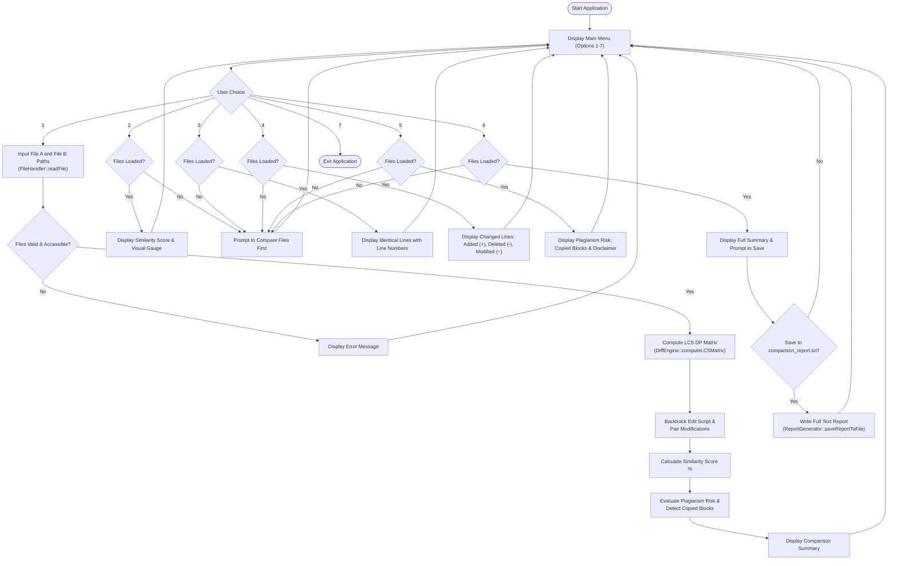

# Mini Diff Tool and Plagiarism Checker

A modular, high-performance C++17 console application that performs line-by-line file comparison, calculates similarity metrics, detects identical and modified text segments, and evaluates potential plagiarism between two text documents using the **Longest Common Subsequence (LCS)** dynamic programming algorithm.

---

## 1. Project Overview

In software development and academic evaluation, identifying structural differences, content revisions, and copied text is essential. Standard Unix `diff` utilities align files using the Longest Common Subsequence algorithm. This project builds upon these principles to deliver both:
1. **A Mini Diff Engine**: Accurately aligns matching text lines and detects **Added (`[+]`)**, **Deleted (`[-]`)**, and **Modified (`[~]`)** lines.
2. **A Plagiarism Checker**: Evaluates structural similarity, extracts multi-line copied blocks, computes a percentage similarity score, and flags high-risk content with a plagiarism warning and academic disclaimer.

---

## 2. Key Features

- **Robust File Handling**: Safely loads text files using `std::ifstream`, strips Windows/Unix newline inconsistencies (`\r\n` vs `\n`), and handles missing or empty files gracefully.
- **Dynamic Programming LCS**: Implements the classic $O(M \times N)$ Longest Common Subsequence algorithm to identify identical lines across documents.
- **Backtracking & Alignment**: Reconstructs optimal edit sequences and groups adjacent deletions and additions into intuitive `MODIFIED` lines.
- **Similarity Scoring**: Computes similarity using the standard formula:
  $$\text{Similarity Score} = \left(\frac{2 \times \text{LCS Length}}{\text{Total Lines in File A} + \text{Total Lines in File B}}\right) \times 100$$
- **Plagiarism Integrity Analysis**: Categorizes risk into **Low**, **Moderate**, **High**, and **Critical**, identifies exact copied blocks with source line numbers, and presents a prominent warning banner when similarity is high.
- **Interactive Menu-Driven CLI**: Clean, formatted console interface with ASCII tables, progress meters, and color-free compatibility for all terminals.
- **Persistent Report Generation**: Generates comprehensive comparison logs and exports them to `comparison_report.txt`.

---

## 3. Technology Stack

- **Language**: C++
- **Standard**: C++17
- **Compiler**: GCC / MinGW (`g++`)
- **Libraries**: C++ Standard Template Library (`<iostream>`, `<fstream>`, `<vector>`, `<string>`, `<algorithm>`, `<iomanip>`, `<sstream>`)
- **IDE**: Visual Studio Code
- **External Dependencies**: None (Zero third-party dependencies)

---

## 4. Project Directory Structure

```text
MiniDiffTool/
├── .vscode/
│   ├── tasks.json             # VS Code build and run task definitions
│   └── launch.json            # VS Code GDB debug configuration
├── samples/
│   ├── file1.txt              # Sample original C++ source file
│   └── file2.txt              # Sample modified/copied C++ source file
├── file_handler.h             # File I/O interface declarations
├── file_handler.cpp           # Safe file reading, writing, and path utilities
├── diff_engine.h              # LCS algorithm and diff data structures
├── diff_engine.cpp            # DP matrix computation, backtracking, and hunk alignment
├── plagiarism_checker.h       # Plagiarism risk assessment structures and interfaces
├── plagiarism_checker.cpp     # Copied block grouping, threshold checks, and warnings
├── report_generator.h         # Terminal tables and text file export declarations
├── report_generator.cpp       # Visual meters, reports, and file persistence
├── main.cpp                   # Menu-driven console interface and application loop
├── comparison_report.txt      # Generated evaluation report
└── README.md                  # Project documentation and viva guide
```

---

## 5. Algorithm & Mathematical Foundation

### 5.1 Longest Common Subsequence (LCS)

Given two sequences of lines $A = \langle a_1, a_2, \dots, a_m \rangle$ and $B = \langle b_1, b_2, \dots, b_n \rangle$:

Let $DP[i][j]$ represent the length of the LCS of prefixes $A[1 \dots i]$ and $B[1 \dots j]$.

The recurrence relation is defined as:

$$
DP[i][j] = \begin{cases}
0 & \text{if } i = 0 \text{ or } j = 0 \\
DP[i-1][j-1] + 1 & \text{if } A[i-1] == B[j-1] \\
\max(DP[i-1][j], DP[i][j-1]) & \text{if } A[i-1] \neq B[j-1]
\end{cases}
$$

- **Time Complexity**: $O(M \times N)$ where $M$ is the number of lines in File A and $N$ is the number of lines in File B.
- **Space Complexity**: $O(M \times N)$ for the dynamic programming table.

### 5.2 Backtracking and Modification Detection

1. **Backtracking**: Starting at cell $(M, N)$:
   - If $A[i-1] == B[j-1]$, the line is **IDENTICAL** (`=`), decrement both $i$ and $j$.
   - Else if $DP[i][j-1] \ge DP[i-1][j]$, the line was **ADDED** (`+`) in File B, decrement $j$.
   - Else, the line was **DELETED** (`-`) from File A, decrement $i$.
2. **Reversal**: Reverse the step list to obtain chronological order from Line 1.
3. **Modification Pairing**: In any diff hunk between identical anchors, a consecutive run of $D$ deletions and $A$ additions is paired up:
   - $\min(D, A)$ pairs become **MODIFIED** lines ($A_k \to B_k$).
   - Remaining deletions ($D > A$) become pure **DELETED** lines.
   - Remaining additions ($A > D$) become pure **ADDED** lines.

### 5.3 Mathematical Invariant

The classification guarantees exact conservation of line counts:
$$
\text{Total Lines in File A} = \text{Identical} + \text{Modified} + \text{Deleted}
$$
$$
\text{Total Lines in File B} = \text{Identical} + \text{Modified} + \text{Added}
$$

### 5.4 Similarity Percentage Formula

$$
\text{Similarity Score} = \left(\frac{2 \times \text{LCS Length}}{\text{Total Lines in File A} + \text{Total Lines in File B}}\right) \times 100
$$

- **Edge Case**: If both File A and File B have 0 lines (both empty), the similarity is defined as **100.00%**.
- **Edge Case**: If one file is empty and the other contains lines, the similarity is **0.00%**.

---

## 6. System Flowchart



---

## 7. Build and Execution Instructions

### Prerequisites
- GCC / MinGW C++ compiler supporting C++17 (`g++ --version` $\ge$ 6.3)
- Visual Studio Code with the C/C++ Extension installed (optional but recommended)

### Option A: Using the Command Line (PowerShell / Command Prompt / Bash)

1. Open a terminal and navigate to the project directory:
   ```bash
   cd "d:/Captures/project daa/MiniDiffTool"
   ```

2. Compile all source files into an executable:
   ```bash
   g++ -std=c++17 -Wall -Wextra main.cpp file_handler.cpp diff_engine.cpp plagiarism_checker.cpp report_generator.cpp -o mini_diff_tool.exe
   ```

3. Run the application:
   - On Windows:
     ```powershell
     .\mini_diff_tool.exe
     ```
   - On Linux / macOS:
     ```bash
     ./mini_diff_tool
     ```

### Option B: Using Visual Studio Code

1. Open the `MiniDiffTool` folder in VS Code (`File` $\to$ `Open Folder...`).
2. Press `Ctrl + Shift + B` (or `Terminal` $\to$ `Run Build Task...`) and select **Build Mini Diff Tool**.
3. To run the program:
   - Open the integrated terminal (`Ctrl + ~`) and type `.\mini_diff_tool.exe`.
   - Alternatively, press `F5` to start debugging with GDB.

---

## 8. Sample Execution & Expected Output

When running with sample files `samples/file1.txt` and `samples/file2.txt`:

### Step 1: Menu Screen
```text
======================================================================
   WELCOME TO THE MINI DIFF TOOL & PLAGIARISM CHECKER CONSOLE APP     
   Developed for Data Structures & Algorithms (C++17) Project        
======================================================================

======================================================================
         MINI DIFF TOOL & PLAGIARISM CHECKER (C++17)                  
======================================================================
  [STATUS]: No files currently loaded or compared.
----------------------------------------------------------------------
  1. Compare Two Text Files
  2. Check Similarity Percentage
  3. View Matching Lines
  4. View Changed Lines (Added / Deleted / Modified)
  5. Detect Potential Plagiarism
  6. Generate Comparison Report (View & Save)
  7. Exit
======================================================================
  Enter your choice (1-7): 1
```

### Step 2: Comparison Summary
```text
======================================================================
  COMPARISON SUMMARY REPORT
======================================================================
  File A (Original):        file1.txt (samples/file1.txt)
  File B (Target):          file2.txt (samples/file2.txt)
----------------------------------------------------------------------
  Total Lines in File A:            28
  Total Lines in File B:            29
  LCS Length (Matched lines):       24
----------------------------------------------------------------------
  [=] Identical Lines:              24
  [~] Modified Lines:                3
  [+] Added Lines:                   2
  [-] Deleted Lines:                 1
----------------------------------------------------------------------
  Overall Similarity Percentage: 84.21 %
======================================================================
```

### Step 3: Plagiarism Warning (Option 5)
```text
======================================================================
  PLAGIARISM DETECTION & INTEGRITY ANALYSIS
======================================================================
  File A (Original):        file1.txt
  File B (Target):          file2.txt
----------------------------------------------------------------------

****************************************************************
*  !!! CRITICAL PLAGIARISM ALERT !!!                           *
*  Over 80% similarity detected! Content appears unoriginal.  *
****************************************************************

  Assessment Summary:
    - Risk Classification  : CRITICAL RISK (Severe Plagiarism)
    - Similarity Percentage: 84.21 %
    - Matching Lines       : 24
    - Overlap Ratio in A   : 85.71 % (24/28 lines)
    - Overlap Ratio in B   : 82.76 % (24/29 lines)
    - Evaluation Note      : CRITICAL: Extreme textual overlap detected. Files are virtually identical or direct copies.

  Identified Copied / Verbatim Blocks (4 detected):
----------------------------------------------------------------------
  Block #1: 6 line(s) matching
    File A: Lines 1 to 6 <===> File B: Lines 1 to 6
    ...
```

---

## 9. Viva / Oral Examination Guide

### Q1: Why is LCS preferred over Hamming Distance or Levenshtein Distance for comparing text files?
**Answer**: Hamming distance requires both sequences to have the exact same length and only counts substitutions at identical indices. Levenshtein distance works at character level and is computationally expensive for large text files. LCS at line-level naturally accommodates insertions, deletions, and line shifts without misaligning the subsequent unchanged lines.

### Q2: How does the tool differentiate between a Modified line and pure Added/Deleted lines?
**Answer**: LCS backtracking yields deletions (`-`) and additions (`+`). When a chunk of deletions is immediately adjacent to a chunk of additions between identical anchor lines, it represents an in-place rewrite. The algorithm pairs up the first $\min(D, A)$ lines as `MODIFIED` ($A_k \to B_k$) and treats any surplus as pure insertions or deletions.

### Q3: What is the significance of line-ending normalization (`cleanLine`)?
**Answer**: Windows files use CRLF (`\r\n`), while Unix files use LF (`\n`). If a student created File A on Windows and File B on Linux or Git, naive string comparison (`==`) would fail on every line due to the trailing `\r`. `cleanLine` removes trailing carriage returns and newlines, ensuring pure content comparison.

### Q4: Does this tool search online databases or Google?
**Answer**: No. As highlighted in the academic disclaimer, this application operates strictly locally in memory between two user-supplied files. It performs lexical syntactic comparison and does not query external web search engines or private institutional databases.

